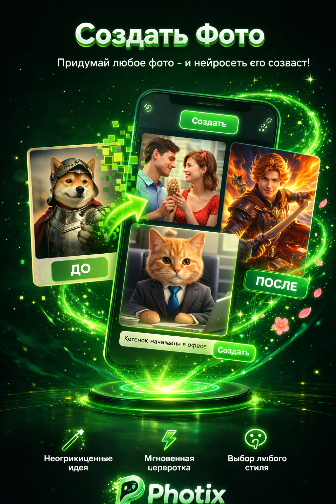
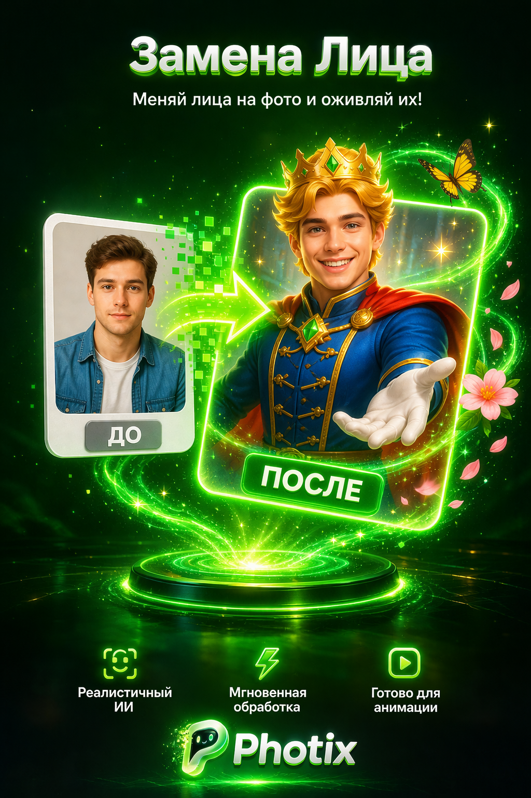
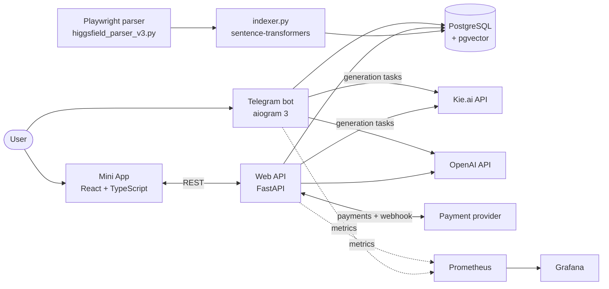
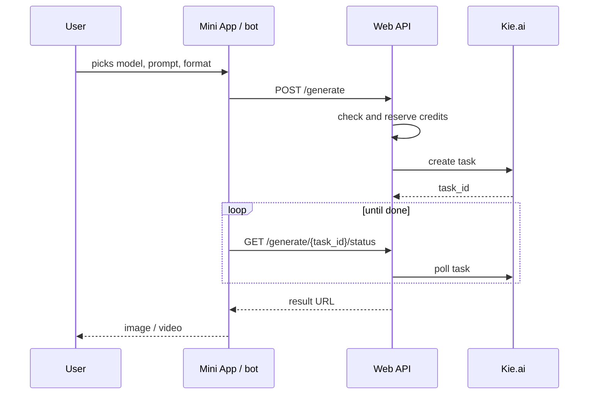
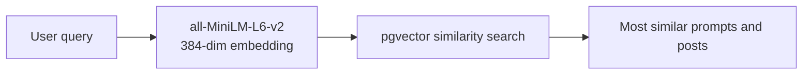

# Photix (GasGen) — AI photo and video generation in Telegram

An AI image and video generation platform delivered through Telegram: a bot, a Telegram Mini App and a web API. Users browse a library of ready-made prompts collected from the Higgsfield community, find similar ones with semantic search, and generate their own photos and videos — text-to-image, "make one like this", face swap, photo animation and video — with credits and online payments.

<p align="center">
  
  
</p>

## Contents

- [Features](#features)
- [Architecture](#architecture)
- [Generation flow](#generation-flow)
- [Semantic search](#semantic-search)
- [API](#api)
- [Getting started](#getting-started)

## Features

| Feature | Description |
|---|---|
| **Prompt library** | Posts with prompts, results and reference images parsed from the Higgsfield community, organised into categories and tags. |
| **Semantic search** | Prompt embeddings (`all-MiniLM-L6-v2`, 384-dim) in PostgreSQL + pgvector — find prompts by meaning, not keywords. |
| **Photo generation** | Pick a model, write a prompt, choose a format, confirm, get the result. |
| **"Make one like this"** | Reproduce any library post with your own photo as the reference. |
| **Face swap** | Replace a face in a photo while keeping the scene. |
| **Animate** | Turn a still photo into a short video. |
| **Video** | Text / image-to-video generation and reels templates. |
| **Credits and payments** | Credit balance per user, pricing and subscription pages, online payments with webhooks. |
| **Admin panel** | Users and credits, categories and tags, stats: overview, daily active users, popular models, payments. |

**Models** (through the Kie.ai API): GPT Image, Flux, Grok Imagine, Kling and others.

## Architecture



```
bot/                 — aiogram 3 bot: menu, categories, search, photo, custom prompt,
                       "generate like", video, animate, face swap, purchase, profile
webapp/              — FastAPI: Telegram auth, posts, categories, generation, uploads,
                       payments, admin
miniapp/             — React + TypeScript Telegram Mini App (home, categories, feed,
                       create hub, generate, animate, video, reels, pricing, profile, admin)
higgsfield_parser_v3.py, indexer.py   — data collection and embedding indexer
migrations/, db_schema.sql, db_analytics_schema.sql — database schema
nginx/, docker-compose*.yml, Dockerfile*            — deployment
```

## Generation flow



## Semantic search



## API

| Method | Path | Purpose |
|---|---|---|
| `POST` | `/auth/telegram` | sign in with Telegram |
| `GET` | `/posts`, `/categories`, `/tags` | prompt library |
| `POST` | `/generate`, `/generate/direct` | start a generation |
| `GET` | `/generate/{task_id}/status` | generation status |
| `POST` | `/upload-reference` | upload a reference photo |
| `POST` | `/payments/.../create`, `/webhook`; `GET /payments/.../status/{order_id}` | payments |
| `GET` | `/users`, `/stats/overview`, `/stats/daily-active`, `/stats/popular-models`, `/stats/payments` | admin |
| `POST` | `/users/{telegram_id}/credits`, `/categories`, `/tags` | admin actions |

## Getting started

```bash
cp .env.example .env              # BOT_TOKEN, OPENAI_API_KEY, KIE_API_KEY, DB_* settings
docker compose up -d              # PostgreSQL, bot, pgAdmin, Prometheus, Grafana
```

Bot only, or the Mini App with its web API:

```bash
docker compose -f docker-compose-bot-only.yml up -d
docker compose -f docker-compose-miniapp.yml up -d
```

Mini App development:

```bash
cd miniapp
npm install
npm run dev
```

See [`DEPLOYMENT.md`](DEPLOYMENT.md) and [`DOCKER_DEPLOYMENT.md`](DOCKER_DEPLOYMENT.md) for production setup with SSL.

## Tech stack

Python, aiogram 3, FastAPI, PostgreSQL + pgvector, sentence-transformers, Playwright, OpenAI API, Kie.ai API, React, TypeScript, Vite, Docker, nginx, Prometheus, Grafana.
